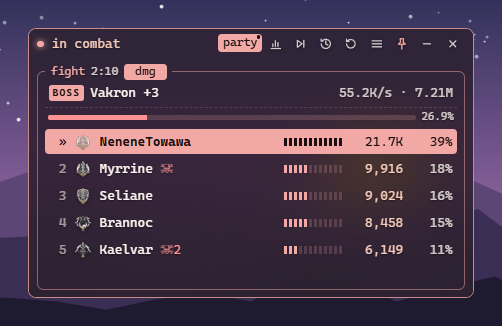
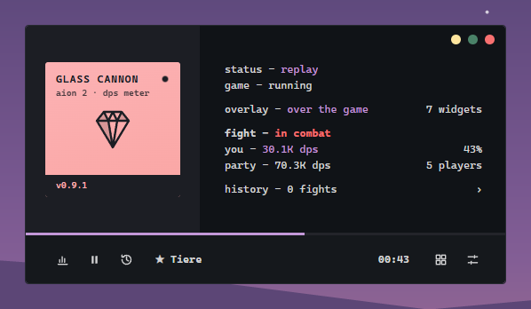
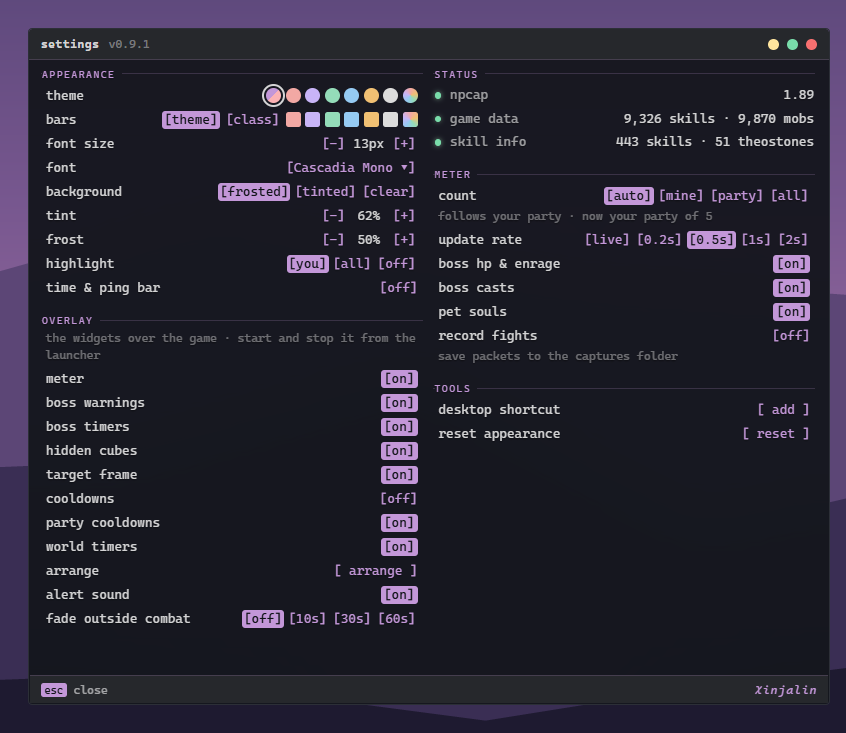
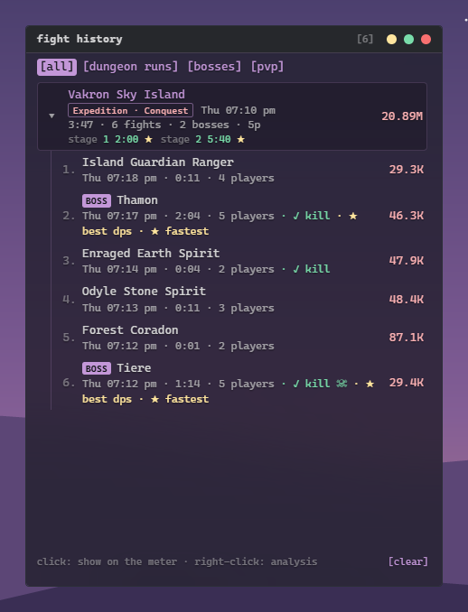
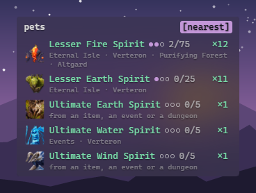
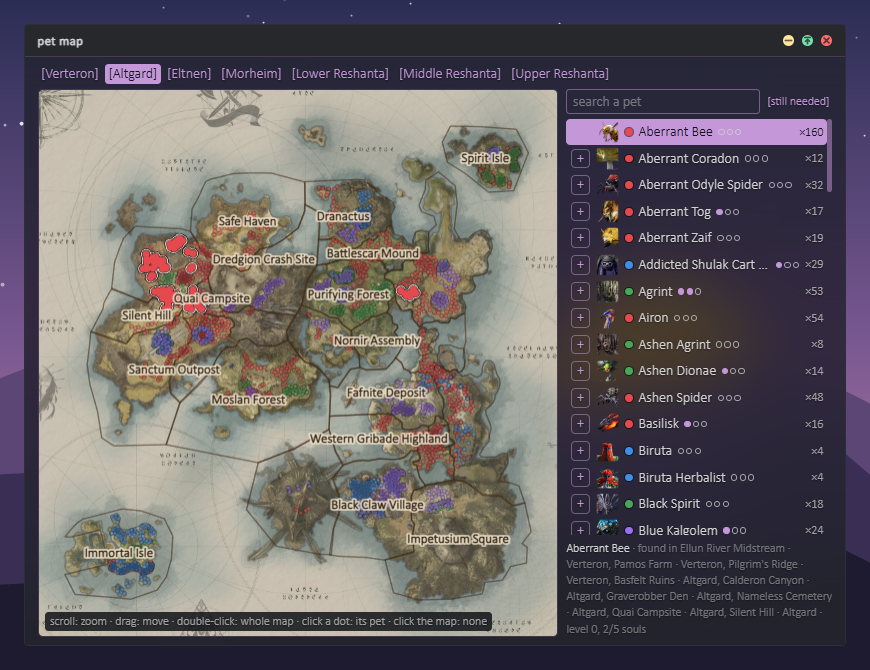
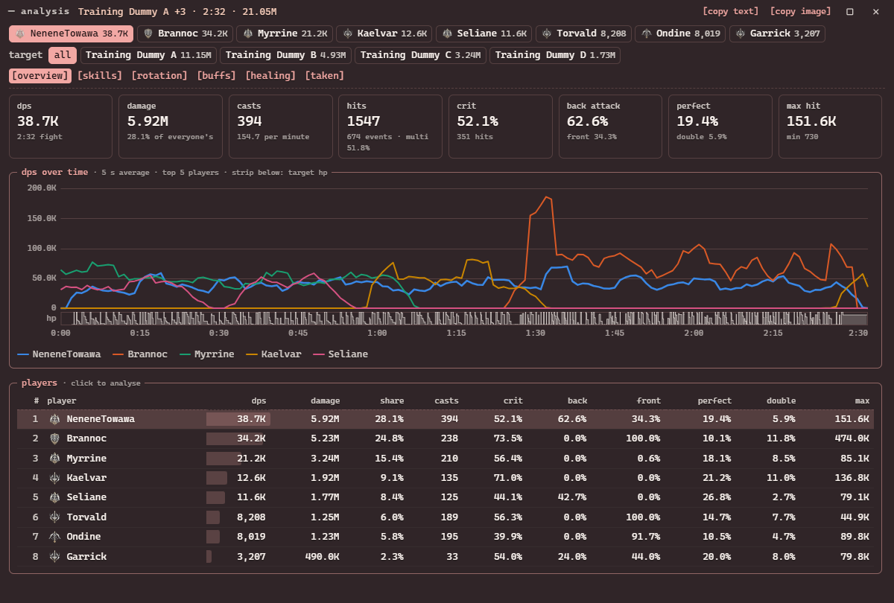

# Glass Cannon

A DPS meter and overlay for **Aion 2** on Windows.

Glass Cannon reads the game's network traffic passively through [Npcap](https://npcap.com).
It never reads or writes the game's memory, needs no admin rights, and never goes online.



## Features

- **Meter**: damage, healing and damage taken for you, your party or everyone nearby, with
  each player's skills and combat power.
- **Overlay**: the meter, target frame, boss warnings and timers, player bars, party
  frames, an action bar of your cooldowns and buffs, and world timers as widgets over the
  game. Arrange them freely; they
  step aside for the world map and full-screen menus.
- **Boss warnings**: dangerous casts, dungeon and raid mechanics with what to do, and when
  the boss turns to you.
- **Analysis**: every fight in detail: skills, rotation, buffs, healing, deaths and the
  boss's casts.
- **History**: fights grouped into dungeon and raid runs, with stage times, personal
  bests, and each character's attempts at every boss.
- **Map and pets**: where each pet's mobs spawn and where to gather, and a tracker for the
  pets you're working on.
- **Black market**: what the Black Cloud Merchant offers each character this hour, with the
  pets you don't have yet marked.
- **Weekly checklist**: each character's Odyle energy and its weekly sources.

## Screenshots

| Launcher | Settings |
| --- | --- |
|  |  |

| Fight history | Pet tracker |
| --- | --- |
|  |  |





<sub>A real dungeon run replayed from a recording over a painted backdrop. Other players'
names are made up.</sub>

## Install

Requires Windows 10 or 11 with WebView2 (built into Windows 11).

1. Install [Npcap](https://npcap.com). Leave **"Restrict Npcap driver's access to
   Administrators only"** unticked, so the meter can run without admin rights, and keep
   **"Support loopback traffic"** ticked (the default), which ExitLag and other ping
   reducers need.
2. Download the zip from [Releases](../../releases) and extract it anywhere.
3. Run `glass-cannon.exe`. The program isn't code-signed, so SmartScreen may ask:
   **More info → Run anyway**.

To update, extract a new release over the old one. Settings and history are kept.

**Ping reducers and VPNs** (ExitLag and the like) work: the meter follows the game's
connection to wherever it goes, a relay on your PC included. If the launcher says Npcap
can't see your PC's own traffic, reinstall Npcap with "Support loopback traffic" ticked.

## Usage

Start Glass Cannon before or after the game. It begins capturing at once and waits for
the game if it isn't running.

| Action | How |
| --- | --- |
| Show the overlay | **▶** on the launcher |
| Open the settings | **≡** on the launcher |
| Arrange the widgets | The launcher's grid button, or **Ctrl+Shift+F10** in game |
| Hide or show the widgets | **Alt+E** in game |
| See a player's skills | Click their row on the meter |
| Open a fight's analysis | Right-click a player, or the chart icon |

Both hotkeys can be changed in the settings. The full guide is in
[docs/guide.md](docs/guide.md).

## Privacy

- **Network**: Npcap captures on the network adapter the game uses (and your PC's own
  loopback traffic, when the game goes through a ping reducer's relay). Packets that aren't
  the game's are dropped as they arrive; nothing is saved unless you turn on recording.
- **Screen**: to step aside for game menus, the overlay looks at a small square in the
  game's top-right corner, a strip at its bottom middle (for reward screens' Confirm
  button) and the top of the screen (for a window's close X, as the Attendance window's),
  only while the cursor is showing. None of it is ever saved, and the setting can be
  turned off.
- **Storage**: settings, history and attempts stay on your PC, in
  `%APPDATA%\io.github.xinjalin.glass-cannon`. Nothing is uploaded.

## Building

Requires Rust (the toolchain in `rust-toolchain.toml`) and Npcap.

```bash
cargo build --release
```

See [docs/development.md](docs/development.md) for the tools, the game data and how
releases are made, and [docs/protocol.md](docs/protocol.md) for what is known about the
game's protocol.

## Disclaimer

Glass Cannon is an unofficial fan project. The game's terms may forbid third-party
meters: use it at your own risk. Aion is a trademark of NCSOFT.

## License

[MIT](LICENSE) © Xinjalin. Game data and third-party software have their own terms: see
[gamedata/README.md](gamedata/README.md) and [THIRD_PARTY.md](THIRD_PARTY.md).
