# Glass Cannon

A DPS meter for **Aion 2** on Windows, in a frosted-glass overlay over the game. It reads
the game's network traffic passively through Npcap, so it never touches the game or its
memory. No admin rights, no auto-updates, and it never goes online.

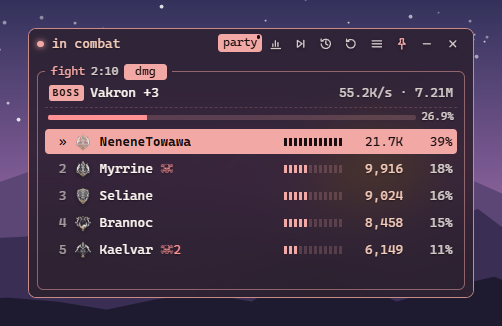

| The launcher | Arranging the overlay |
| --- | --- |
| 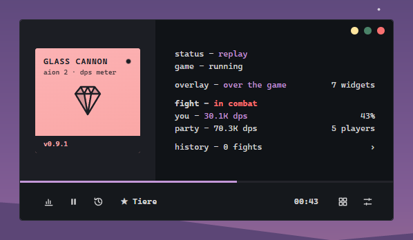 | 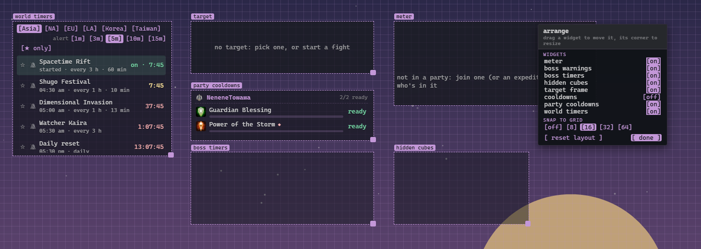 |

| The meter in a boss fight | A player's skills |
| --- | --- |
| 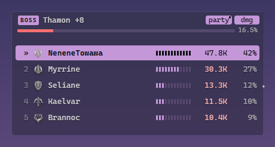 | 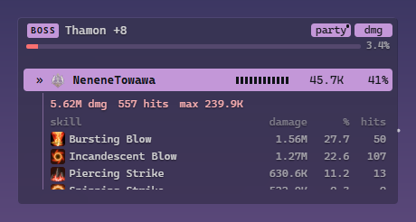 |

| Fight history | Settings |
| --- | --- |
| 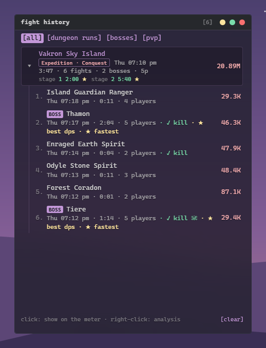 | 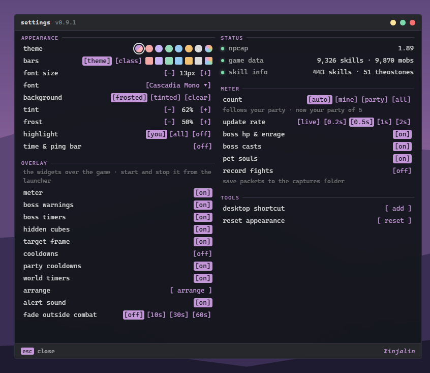 |

| Dummy mode | Pet tracker |
| --- | --- |
| 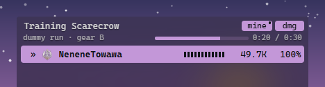 | 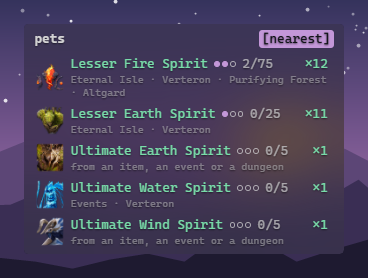 |

![Two dummy runs compared in the history's [dummy] tab: the DPS difference, with crit luck taken out, and each skill's damage](docs/screenshots/dummy-history.png)

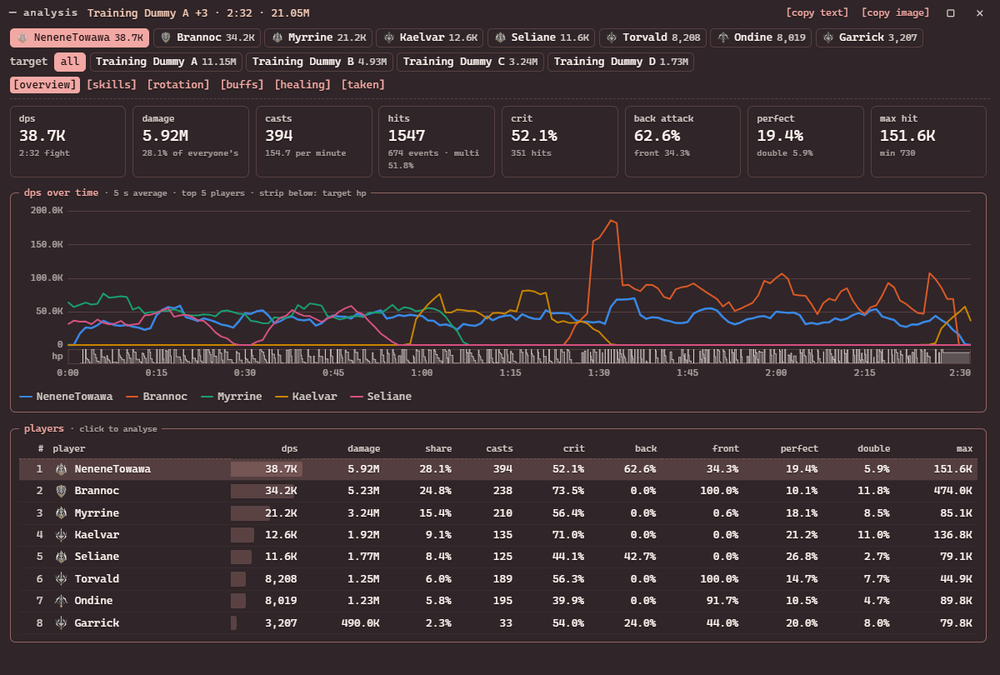

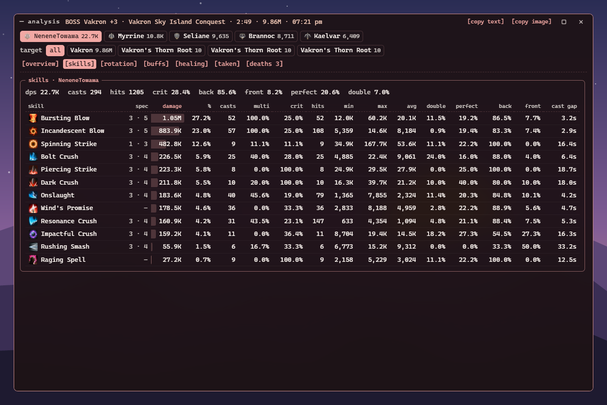

| Rotation | Buffs |
| --- | --- |
| 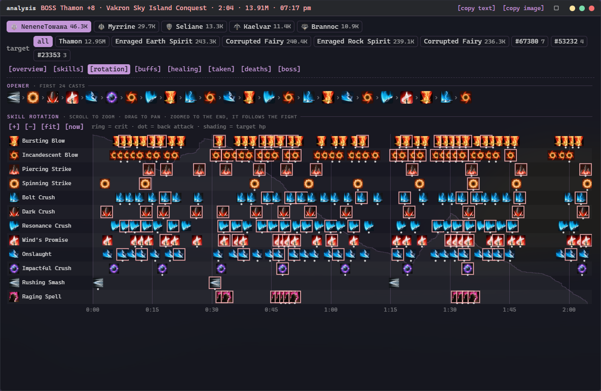 | 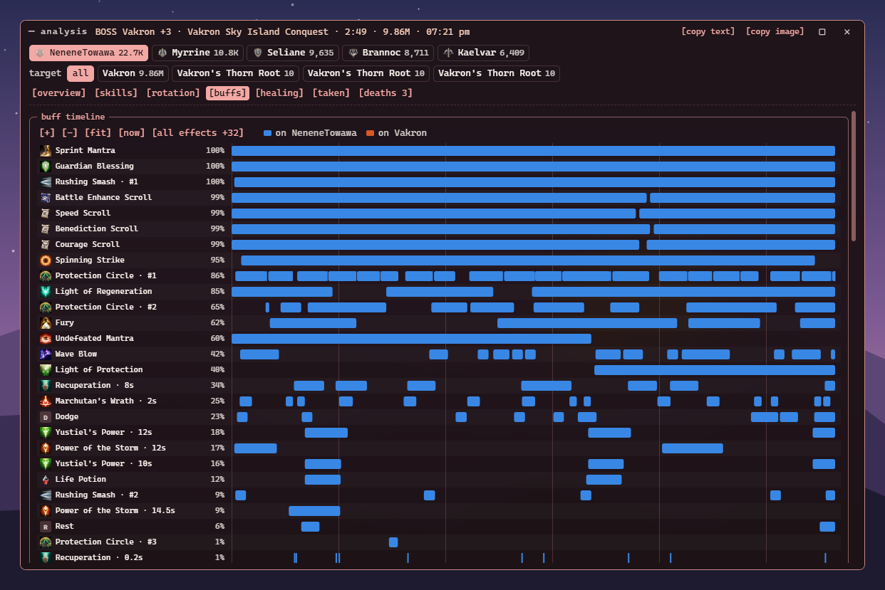 |

| Healing | Deaths |
| --- | --- |
| 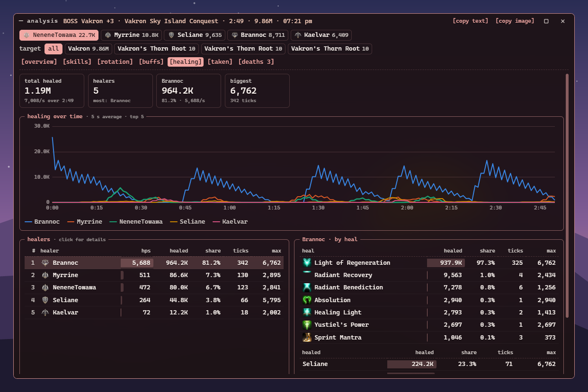 | 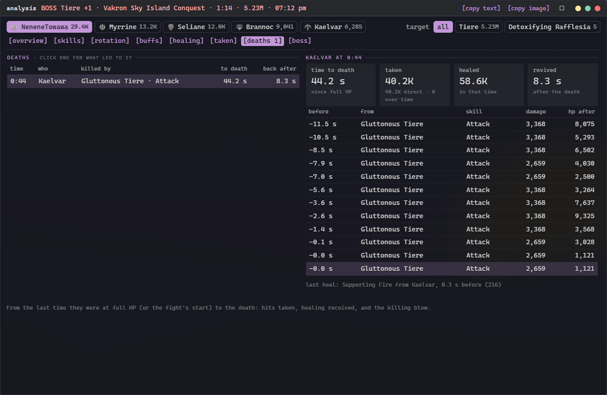 |

<sub>A real dungeon run replayed from a recording over a painted backdrop, with other
players' names made up.</sub>

## Install

1. Install [Npcap](https://npcap.com). Leave **"Restrict Npcap driver's access to
   Administrators only"** unticked, so the meter doesn't need admin rights.
2. Download the zip from [Releases](../../releases) and extract it anywhere.
3. Run `glass-cannon.exe`. It isn't code-signed, so SmartScreen may ask: **More info →
   Run anyway**.

To update, extract a new release over the old one; your settings and history are kept.
Needs Windows 10 or 11 with WebView2 (built into Windows 11).

## Using it

It starts capturing straight away and waits for the game if it isn't running.

### The launcher

Glass Cannon opens to a small **launcher**, laid out like a music player, in its own
colours whatever the theme:

- **the cover**: click it for the analysis of the fight going on, or the last one;
- **the list**: the status (capturing, waiting…) and the game's ping, whether the game is
  running, the overlay, how the fight is going or how it ended, your DPS and share, the
  party's, and the history;
- **the bar**: the fight's target and time against the boss's enrage, the boss's HP as its
  progress line, and buttons for the analysis, the overlay's start/stop, the history,
  arranging the overlay (again to save and finish) and the settings;
- **the lights** at the top right: minimise, keep on top, and close (which closes the
  app).

Text too long for its line slides along rather than being cut off.

### The overlay

One transparent layer over the game's picture holding the meter and the other widgets, in
your theme. It follows the game window, hides when you switch away, never takes the focus
from the game, and lets the mouse through except over the meter and the world timers.

**Arrange** (on the launcher, or in the settings) moves widgets and resizes them by their
corner, snapping to a grid (8, 16, 32 or 64 px, or none) shown while arranging. Widgets
that grow with what they show (the target frame, cooldowns, party cooldowns) are outlined
at the most they'll take, so they can be placed clear of each other. Its
floating menu (drag it by its title) turns each widget on or off, resets the layout, and
finishes. The widgets:

- **meter**: the players, below.
- **boss warnings**: a dangerous cast big in the middle of the screen, its time left, then
  when it lands, with a chime; a heads-up 5 s before one is due. A cast is dangerous when
  it marks the ground or takes 2.5 s or more; in the analysis window's [boss] tab, click a
  skill's alert to make it always or never warn.
- **boss timers**: the boss's next casts from your last fight against it, as bars counting
  down.
- **hidden cubes**: an alert when a hidden cube (gold or red) comes into view, with a
  sound (settings → alert sound); opened cubes show briefly as taken. It can't say which
  way the cube is: the game never sends your own position as you move (and what your game
  sends is encrypted).
- **target frame**: your target's HP, time to kill, what it's casting, enrage, who it's
  attacking, your best against it, stagger. While it shows, the meter leaves out its own
  boss HP, enrage and cast lines, so nothing is shown twice.
- **cooldowns**: your skills that aren't ready, with time left and charges.
- **party cooldowns**: your party's long cooldowns and party buffs, ready or time left
  (yours from the start, the others' once used).
- **world timers**: rifts, invasions, sieges, Arena of Tactics (NA, EU and LA), resets and
  field bosses (open the world map in game to read them) in your time; hover an event for
  its next three starts. Star (☆) the ones you want and **[★ only]** shows just those, and
  ring the 🔔 for an alert on the meter before one starts. Also who holds the
  Abyss artifacts (when you open the Abyss map or enter it; not tested in game yet), your
  Odyle energy, and your content tickets: the game doesn't name them, so double-click one
  to give it a name.

- **pet tracker**: the pets you track (settings → pet tracker lists every pet with its
  portrait: search one, or an area, and click [track]) with their level, souls toward the
  next one and every area they're found in; a pet whose mobs are in view turns green with
  how many, and how far and which way while the meter knows where you are (for a minute
  after you log in, teleport or change zone). **[nearest]** shows every pet you still need
  whose mobs are in view, tracked or not, nearest first. Which mobs give which souls is from Aion
  DPS Meter's data; a few mobs aren't in it.

**Hide on the world map** (settings, on by default): the overlay steps aside while the
world map is open and comes back within about 1.5 s of closing it. The game asks for the map's
contents about every 1.2 s while it's open, and that's how the meter knows.

**Fade outside combat** (settings) fades the fight widgets a while after the last fight;
they come back with the next one (the meter under the mouse too). With the **frosted**
background, Windows blurs the game behind each widget; **frost** sets how milky that glass
looks.

### The meter

- **auto / mine / party / all**: whose damage counts. *auto* (the default) follows your
  party: your party's fight while you're in a party or expedition, yours on your own.
  *mine* is only your damage, *all* everyone's nearby.
- **dmg / heal / taken / party**: damage dealt, healing done (heals over time and
  self-heals), damage taken from mobs, or your party with each member's combat power and
  gear score, and a ✓ for who's readied up in the party finder. A line under the meter says
  who joins, leaves or readies up.
- **Click a player** for their skills. Double-click a skill or the target to rename it.
- A fight ends on the boss's kill (**✓**), when the boss resets (**✗ wipe**), when your
  party leaves combat, on a map change, or after 15 s of quiet; **▷|** ends it now. A live
  boss fight shows the boss's HP and enrage timer; a **☠** marks who died.
- Over the meter, its buttons appear beside the two switches: back (from a saved fight),
  analysis, end the fight, history, and **≡** for the settings: theme (*night*, the
  default, or rose, lavender, mint, sky, amber, mono, or any colour), font, background,
  frost, the overlay's widgets, update rate (*live* or every 0.2–2 s), fading outside
  combat, recording and status checks.

### Analysis

**Right-click a player** (or the chart icon, on the meter or the launcher) for the full
fight; right-click again to close it. Tabs:

- **overview**: DPS, crits, positionals and DPS over time with the target's HP.
- **skills**: every skill with the player's chosen specialties and accuracy (hits the
  target evaded, resisted or was immune to are misses); hover for the tooltip.
- **rotation**: the opener and a zoomable cast timeline that follows a live fight.
- **buffs**: buff and debuff uptime with icons, and which buffs were up for each skill.
- **healing** and **taken**: who healed whom (heals on allies, and HP a player's hits
  drain back, included) and what hit whom.
- **deaths**: who died to what, the last hits with HP after each, the healing before, and
  how long until they were revived.
- **boss**: the boss's casts from its pull, with cast times and when their areas landed.

**[copy text]** and **[copy image]** put a summary on the clipboard for Discord.

### History and dungeon runs

The **clock icon** (on the meter or the launcher) opens the history window with the last
200 fights (the newest 50 keep their full analysis), dungeon runs, bosses and PvP sessions;
click a fight to show it on the meter.
Fights in a dungeon are grouped into **runs** with the dungeon, mode, fight time, bosses,
damage and, when the game says it was completed, the clear time (✓) and each stage's
time; your fastest clear and stages of a dungeon and mode get a ★. Right-click a run for
one analysis of all its fights, or a fight for that fight. A run is one entry into the
dungeon (older fights: no break over 10 minutes and no boss fought twice). **[clear]** at
the bottom deletes every fight, dungeon run and PvP session (it asks first); a dungeon
you're in at the time keeps grouping its next fights as a run.

**Personal bests**: your highest DPS and fastest kill against each boss show during the
fight on the meter's boss line, or the target frame while it shows (green while you're
beating it), and as ★ tags on the fights in the history that set them. They're kept per
character, count every kill you were in, and [clear] resets them.

**Dummy mode** (history → [dummy]; on by default): hit a Training Scarecrow and the meter
counts your damage only and times a run (30 s to 5 min, 1 min by default) from your first
hit. A line under the target shows the run's time and your pace against your best clean
run of that length. A run you keep up to the end is saved when the fight ends; one you
stop early isn't. A run is *clean* when no other player buffed you or debuffed the dummy,
so it compares fairly. The [dummy] tab lists your runs (double-click one to label it, with
a gear set or a rotation; right-click to delete it), each label's average, and compares any
two you click: the DPS difference, the difference at the same crit rate (what's left once
crit luck is taken out), and each skill's damage. Give new runs a label with [label].

**Pet souls** (settings → pet souls): a kill that gives a pet's soul shows on the meter with
how many it has toward the pet's next level (5 to summon it, then 25 and 75), e.g. "Red
Spark Ignus soul +1 · 4/25 to level 2". The game sends your pets when you log in, enter or
leave a dungeon and with some other moves, but not every zone change; the meter keeps each
character's from the first time, so it knows them even when started in between.

**Boss casts**: under the boss's HP on the meter (settings → boss casts; the target frame
has them instead while it shows), what it's casting with a bar and the time left, then,
for skills that mark the ground, how long until they land; between casts, what it cast
next the last time you fought it, with a countdown. Times run from the
boss's pull, so they line up from one fight to the next; its routine skills are left out.
The analysis window's **[boss]** tab lists every cast of a fight; most boss skills have no
name in the game data, so double-click one there to name it.

### Windows

The launcher, settings, history and analysis are windows, with the same lights at the top
right of their title bars (minimise, keep on top, close). Each opens where you last left it
(the first time beside the launcher, or in game, or with the launcher minimised, in the
middle of the screen), and takes the background chosen in the settings (the settings and
analysis windows stay tinted enough to read).

### Names

Players are named when they come into view, after a zone change, or when they start a
fight; until then they show as `#ID`. Mobs and NPCs are named from the game data; the few
it doesn't have (and mobs already there when the meter started) show as **Unknown**, with
their type in the tooltip: double-click the target on the meter to name one. You're
recognised on your first hit on a real mob.

## Game data

The `gamedata` folder holds skill, mob, NPC and class names, icons, skill details,
Theostone effects, dungeon mobs and pets. It isn't under the MIT licence: see
[gamedata/README.md](gamedata/README.md) for sources and how to update it.

If skills show as numbers, check `meter.log` in `%APPDATA%\io.github.xinjalin.glass-cannon`.
That folder also holds your settings, history and the names you typed.

## Building

Needs Rust (stable, MSVC) and [Npcap](https://npcap.com); no Npcap SDK.

```bash
cargo build --release
```

`scripts/package.ps1` builds the release zip. CI builds every push; pushing a `vX.Y.Z`
tag (after bumping `Cargo.toml` and writing `docs/releases/vX.Y.Z.md`) publishes a release.

## packet-lab

The command-line tool behind the meter: it captures and inspects the game's traffic. Run
`target/release/packet-lab --help` for every command.

```bash
# Capture until Ctrl+C
target/release/packet-lab capture --process AION2

# The meter over a recording, or the meter live in the terminal
target/release/packet-lab meter captures/<session> --party
target/release/packet-lab live

# Every message of one type, or which messages contain a number you saw in game
target/release/packet-lab messages captures/<session> 8d00
target/release/packet-lab find captures/<session> 2674

# Count the message types, or write every message of recordings as JSON lines
# (session, flow, time, opcode, payload in hex) for analysis in other tools
target/release/packet-lab opcodes captures/<session>
target/release/packet-lab export captures/<session> captures/<other> --out all.jsonl
```

### Packet Lab (GUI)

`target/release/packet-lab-gui` (`cargo build --release -p packet-lab-gui`) shows the
message stream as it comes in, live from the game or from a recording (a session or flow
folder, all at once or played at 1×, 4× or 16×). Only what the server sends can be read:
what your game sends is encrypted. The window has:

- **opcodes** by family, each marked by how well it's understood (decoded, understood,
  named elsewhere, unknown, or not in the notes at all), with counts and rates; click one
  (or a family) to show only it, ctrl-click to add more;
- **the stream** through that filter, following the newest (scroll up to stop), or frozen;
- **one message**: its bytes, and every reading of the value at the byte you click (u8 to
  u64, f32, varint, zigzag, a length-first string, a timestamp);
- **find** a number (as varint, u16, u32 or u64) or bytes in hex, across the stream and
  marked in the message.

What each opcode is comes from [docs/opcodes.md](docs/opcodes.md), built in: of the 428
opcodes in our recordings, 52 are decoded by the meter and 49 more understood. These include
other players' and mobs' movement, targets, skill acknowledgements, chain skills, loot and
the login lists. 109 are named by other projects but not checked yet, and 218 rare ones
(0.26 % of the traffic) are unknown. Learn something new? Fix its row in the notes and
rebuild; the window shows it from then on. It uses Glass Cannon's launcher colours, and
`--hidden` starts it without a window, for scripted checks.

The app replays a recording with `glass-cannon.exe --replay <session> --speed 10` (the
overlay then covers the launcher's screen); `--hidden` starts it without the launcher, for
scripted checks.
What's known about the protocol is in [docs/protocol.md](docs/protocol.md). Captures go to
`captures/` and can hold login tokens: don't share them.

## Ground rules

- The protocol is worked out from our own captures. Leads from open-source projects
  (NOIA2, RATmeter, Aion DPS Meter and the others in
  [docs/opcodes.md](docs/opcodes.md#sources)) are re-checked and implemented
  independently; nothing from closed-source meters.
- Some game data is scraped without a licence and will be removed on request (see
  [gamedata/README.md](gamedata/README.md)).
- The game's terms may forbid third-party meters. Use at your own risk.

## License

[MIT](LICENSE) © Xinjalin. Third-party software and data: [THIRD_PARTY.md](THIRD_PARTY.md).
Aion is a trademark of NCSOFT; this is an unofficial fan project.
