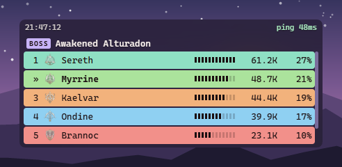
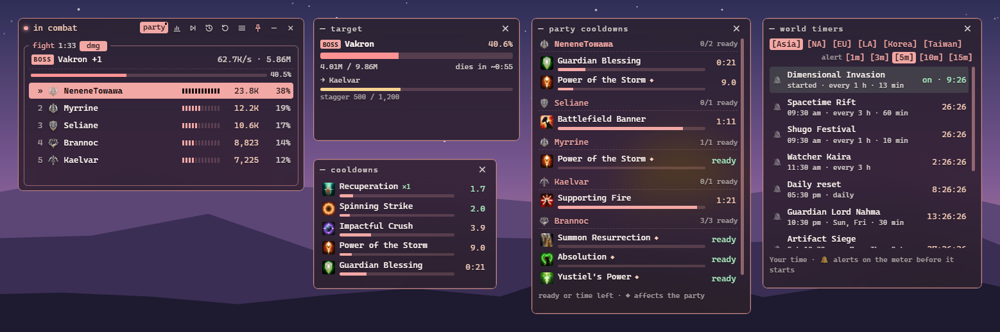

# Glass Cannon

A frosted-glass DPS meter for **Aion 2** on Windows. It reads the game's network traffic
passively through Npcap, so it never touches the game or its memory. No admin rights, no
auto-updates, and it never goes online.


| Skill breakdown | Minimal mode, class-coloured bars |
| --- | --- |
|  |  |



| Fight history | Settings |
| --- | --- |
|  |  |


| Rotation | Buffs |
| --- | --- |
|  |  |

| Healing | Deaths |
| --- | --- |
|  |  |

<sub>A real dungeon run replayed from a recording, with other players' names made up.</sub>

## Install

1. Install [Npcap](https://npcap.com). Leave **"Restrict Npcap driver's access to
   Administrators only"** unticked, so the meter doesn't need admin rights.
2. Download the zip from [Releases](../../releases) and extract it anywhere.
3. Run `glass-cannon.exe`. It isn't code-signed, so SmartScreen may ask: **More info →
   Run anyway**.

To update, extract a new release over the old one; your settings and history are kept.
Needs Windows 10 or 11 with WebView2 (built into Windows 11).

## Using the meter

It starts capturing straight away and waits for the game if it isn't running.

- **auto / mine / party / all**: whose damage counts. *auto* (the default) follows your
  party: your party's fight while you're in a party or expedition, yours on your own.
  *mine* is only your damage, *all* everyone's nearby.
- **dmg / heal / taken / party**: damage dealt, healing done (heals over time and
  self-heals), damage taken from mobs, or your party with each member's combat power and
  gear score, and a ✓ for who's readied up in the party finder. The party shows by itself
  when someone joins, leaves or readies up between fights, and a line under the meter
  says who.
- **Click a player** for their skills. Double-click a skill or the target to rename it.
- A fight ends on the boss's kill (**✓**), when the boss resets (**✗ wipe**), when your
  party leaves combat, on a map change, or after 15 s of quiet. **▷|** ends it now; **↺**
  resets. A live boss fight shows the boss's HP and enrage timer; a **☠** marks who died.
- **Lock** (bottom right): clicks pass through to the game. Click it again to unlock.
- **≡** opens the settings: theme (or any colour), font, background, minimal mode, update
  rate (*live* or every 0.2–2 s), fading outside combat, recording, status checks, and
  the windows below.

### Analysis

**Right-click a player** (or the chart icon) for the full fight; right-click again to
close it. Tabs:

- **overview**: DPS, crits, positionals and DPS over time with the target's HP.
- **skills**: every skill with the player's chosen specialties; hover for the tooltip.
- **rotation**: the opener and a zoomable cast timeline that follows a live fight.
- **buffs**: buff and debuff uptime with icons, and which buffs were up for each skill.
- **healing** and **taken**: who healed whom and what hit whom.
- **deaths**: who died to what, the last hits with HP after each, the healing before, and
  how long until they were revived.

**[copy text]** and **[copy image]** put a summary on the clipboard for Discord.

### History and dungeon runs

The **clock icon** opens the history window with the last 200 fights (the newest 50 keep
their full analysis), dungeon runs, bosses and PvP sessions; click a fight to show it on
the meter.
Fights in a dungeon are grouped into **runs** with the dungeon, mode, fight time, bosses,
damage and, when the game says it was completed, the clear time (✓). Right-click a run for
one analysis of all its fights, or a fight for that fight. A run is one entry into the
dungeon (older fights: no break over 10 minutes and no boss fought twice).

### Windows

Open from the settings; each stays where you put it and opens again next time.

- **cooldowns**: your skills that aren't ready, with time left and charges.
- **party cooldowns**: your party's long cooldowns and party buffs, ready or time left
  (yours from the start, the others' once used).
- **target frame**: your target's HP, time to kill, what it's casting, enrage, who it's
  attacking, stagger.
- **world timers**: rifts, invasions, sieges, resets and field bosses (open the world map
  in game to read them) in your time; ring the 🔔 for an alert on the meter before one
  starts.

### Names

Players are named when they come into view, after a zone change, or when they start a
fight; until then they show as `#ID`. Mobs that were already there when the meter started
show as `#ID` too. You're recognised on your first hit on a real mob.

## Game data

The `gamedata` folder holds skill, mob and class names, icons, skill details, Theostone
effects and dungeon mobs. It isn't under the MIT licence: see
[gamedata/README.md](gamedata/README.md) for sources and how to update it.

If skills show as numbers, check `meter.log` in `%APPDATA%\io.github.xinjalin.glass-cannon`.
That folder also holds your settings, history and the names you typed.

## Building

Needs Rust (stable, MSVC) and [Npcap](https://npcap.com); no Npcap SDK.

```bash
cargo build --release
```

`scripts/package.ps1` builds the release zip. CI builds every push; pushing a `vX.Y.Z`
tag (after bumping `Cargo.toml` and writing `docs/releases/vX.Y.Z.md`) publishes a release.

## packet-lab

The command-line tool behind the meter: it captures and inspects the game's traffic. Run
`target/release/packet-lab --help` for every command.

```bash
# Capture until Ctrl+C
target/release/packet-lab capture --process AION2

# The meter over a recording, or the meter live in the terminal
target/release/packet-lab meter captures/<session> --party
target/release/packet-lab live

# Every message of one type, or which messages contain a number you saw in game
target/release/packet-lab messages captures/<session> 8d00
target/release/packet-lab find captures/<session> 2674
```

The meter replays a recording with `glass-cannon.exe --replay <session> --speed 10`.
What's known about the protocol is in [docs/protocol.md](docs/protocol.md). Captures go to
`captures/` and can hold login tokens: don't share them.

## Ground rules

- The protocol is worked out from our own captures. Facts from the open-source NOIA2 and
  RATmeter meters are re-checked and implemented independently; nothing from closed-source
  meters.
- Some game data is scraped without a licence and will be removed on request (see
  [gamedata/README.md](gamedata/README.md)).
- The game's terms may forbid third-party meters. Use at your own risk.

## License

[MIT](LICENSE) © Xinjalin. Third-party software and data: [THIRD_PARTY.md](THIRD_PARTY.md).
Aion is a trademark of NCSOFT; this is an unofficial fan project.
