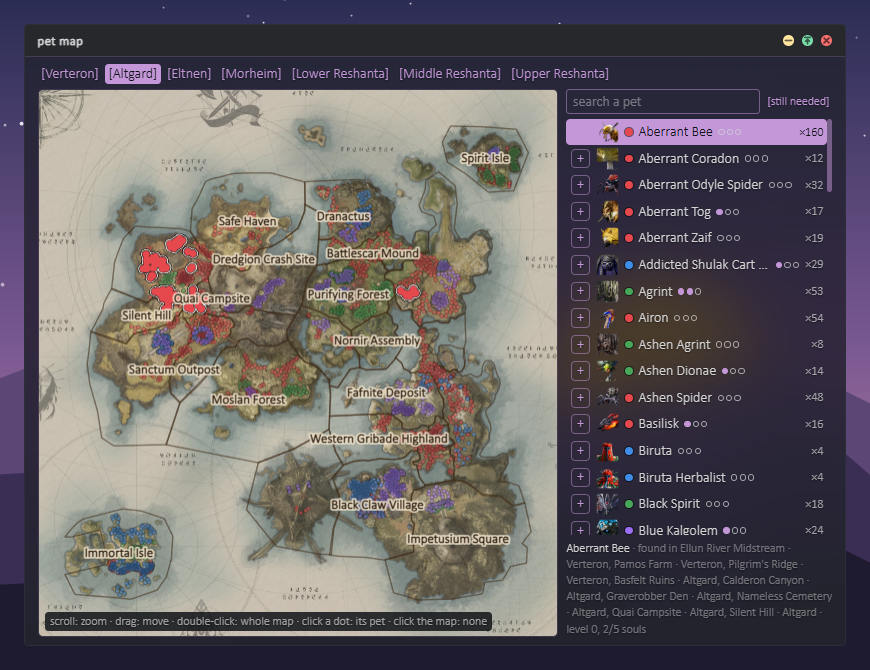

# Glass Cannon

A DPS meter and overlay for **Aion 2** on Windows. It reads the game's network traffic
passively (through Npcap), so it never touches the game or its memory. No admin rights,
no auto-updates, and it never goes online.

- **The meter**: damage, healing or damage taken, for you, your party or everyone nearby,
  with each player's skills.
- **An overlay over the game**: the meter, the target with the boss's HP and casts, your
  HP and MP, party frames, party cooldowns, world timers and more. Arrange the widgets
  where you like; they step aside for the world map and full-screen game menus.
- **Fight analysis and history**: every fight and dungeon run kept, with personal bests,
  rotation, buffs, healing and deaths.
- **Pets**: a pet map of where each pet's mobs spawn, and a tracker for the pets you're
  working on.

## Screenshots

| The launcher | Settings |
| --- | --- |
|  |  |

| Fight history | Pet tracker |
| --- | --- |
|  |  |

A real dungeon run replayed from a recording over a painted backdrop, with other
players' names made up.

## Install

1. Install [Npcap](https://npcap.com). Leave **"Restrict Npcap driver's access to
   Administrators only"** unticked, so the meter doesn't need admin rights.
2. Download the zip from [Releases](../../releases) and extract it anywhere.
3. Run `glass-cannon.exe`. It isn't code-signed, so SmartScreen may ask: **More info →
   Run anyway**.

Needs Windows 10 or 11 with WebView2 (built into Windows 11). To update, extract a new
release over the old one: your settings and history are kept.

## Run

Start Glass Cannon before or after the game: it starts capturing straight away and waits
for the game if it isn't running.

- The **launcher** opens first: press ▶ to put the overlay over the game, and ≡ for the
  settings (theme, font, which widgets show, keybinds).
- **Arrange** (the launcher's grid button, or **Ctrl+Shift+F10** in game) moves and resizes
  the widgets; again to save.
- **Alt+E** hides the widgets in game and brings them back.
- Click a player on the meter for their skills; the launcher's buttons open the analysis,
  the history and the pet map.

Everything it does, in detail: [docs/guide.md](docs/guide.md). Building it and the tools
behind it: [docs/development.md](docs/development.md).

The game's terms may forbid third-party meters: use it at your own risk.

## License

[MIT](LICENSE) © Xinjalin. Game data and third-party software have their own terms:
[gamedata/README.md](gamedata/README.md) and [THIRD_PARTY.md](THIRD_PARTY.md). Aion is a
trademark of NCSOFT; this is an unofficial fan project.
